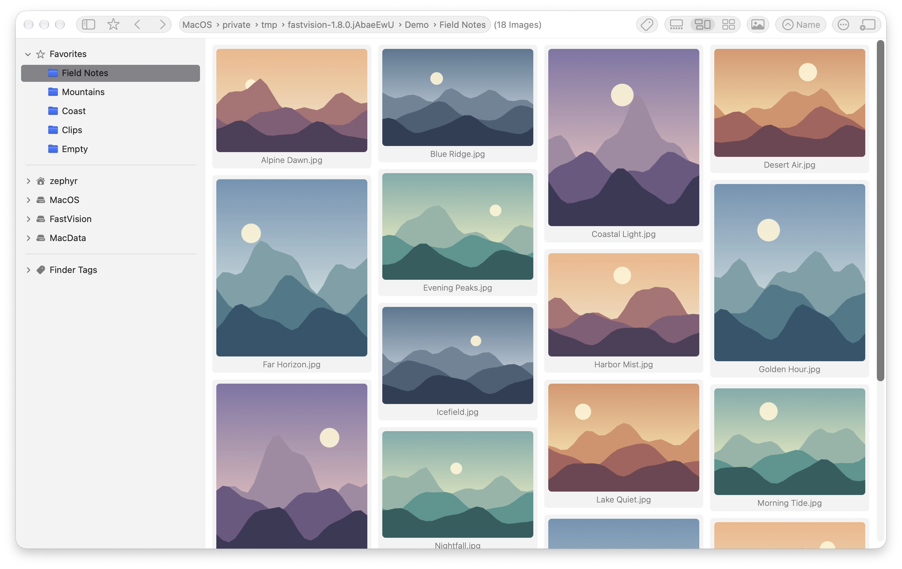
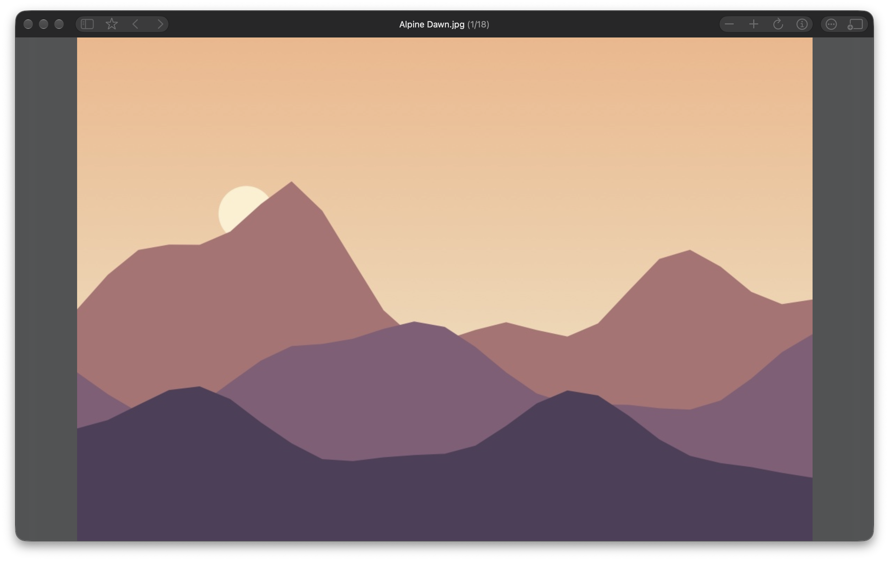
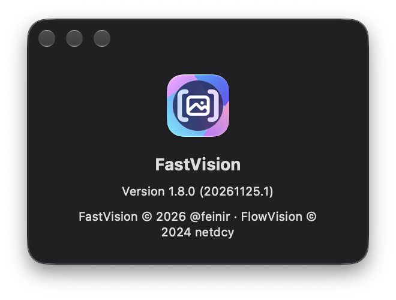

# FastVision

FastVision is the Fast series photo and video browser for macOS for collections organized in folders. Open a local folder, scan a wall of thumbnails, and jump straight to the image you want to see at full size.

[简体中文](README_zh.md) · [Downloads](https://github.com/feinir/FastVision/releases) · [Issues](https://github.com/feinir/FastVision/issues)

## Screenshots

Captured in FastVision 1.8.0 with a sample collection.

| Image preview | About FastVision |
| --- | --- |
|  |  |

## What you can do

- Browse folders in waterfall, grid, or justified layouts. Enable recursive browsing to see media from subfolders together.
- Keep frequently used folders in Favorites and open Home, mounted volumes, and Finder Tags from the sidebar.
- Search by file name, filter by Finder tag or rating, and open folders in tabs.
- Find similar photos from the toolbar or photo context menu, mark photos across groups, and review the full list before moving them to the Trash.
- Open **Edit Photo** for rectangular cropping, perspective correction, rotation, and editable shape, text, and brush annotations. Choose **Save** or **Save As** when the edit is ready.
- Zoom in on photos, view HDR images on supported displays, and preview or play videos.
- Copy, move, rename, and reveal files in Finder from the browser.

## Get started

FastVision requires **macOS 12 or later** and supports both Apple Silicon and Intel Macs. Download the DMG for a published version from [GitHub Releases](https://github.com/feinir/FastVision/releases), open it, and drag FastVision into Applications. Each release links to the corresponding source, including the bundled dependencies, and provides the DMG’s SHA-256 checksum.

Use **File → Open…** to choose a folder. Double-click a thumbnail to open the preview, then use the arrow keys to browse or press **Esc** to return to the thumbnails. Use **⌘F** to search.

## Build from source

Install Xcode and build the eight FFmpeg frameworks using the [pinned sources and macOS build instructions](third_party/ffmpeg/README.md). The same guide shows how to stage the dependencies and build the FastVision Xcode target. The [application dependency lock](third_party/app-sources/source-lock.json) records the remaining source revisions.

## Project origin and license

FastVision is maintained independently by [@feinir](https://github.com/feinir). FastVision forked [FlowVision](https://github.com/netdcy/FlowVision), originally developed by netdcy and the FlowVision contributors, on 2026-11-25. FastVision has its own name, icon, documentation, releases, and interface changes. The repository preserves upstream history and attribution.

FastVision is distributed under the [GNU General Public License v3](LICENSE). Third-party components retain their own notices and licenses. See the [FFmpeg notices](third_party/ffmpeg/licenses/) and [application dependency licenses](third_party/app-sources/licenses/).
