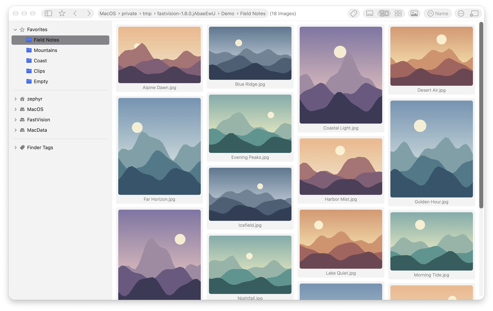
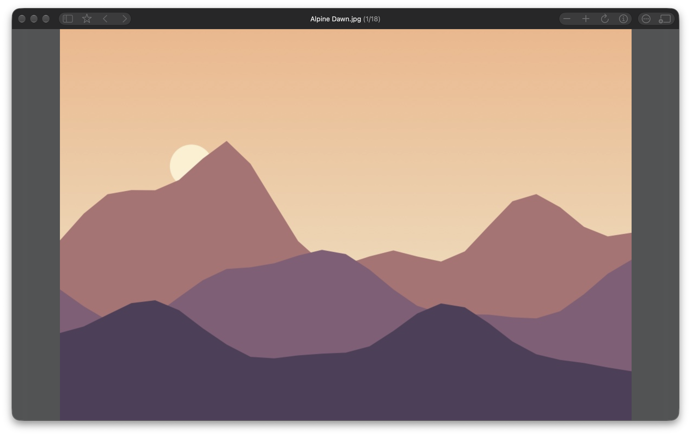
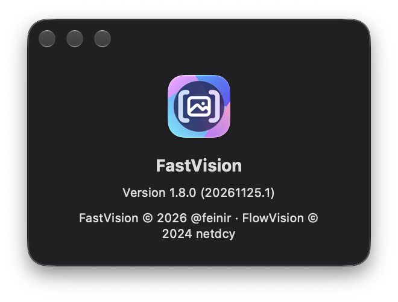

# FastVision

FastVision 是 Fast 系列的 macOS 图片和视频浏览器，适合按文件夹整理摄影作品、设计素材和视频片段。选一个本地目录，从满屏缩略图里找到想看的内容，再打开大图或播放视频。

[English](README.md) · [下载](https://github.com/feinir/FastVision/releases) · [问题反馈](https://github.com/feinir/FastVision/issues)

## 应用截图

截图来自运行中的 FastVision 1.8.0，使用的是示例图库。

| 大图预览 | 关于 FastVision |
| --- | --- |
|  |  |

## 可以用它做什么

- 在瀑布流、网格和等高布局之间切换，或开启递归浏览，一次查看子文件夹里的媒体。
- 把常用目录加入收藏夹，从侧栏进入个人主目录、已挂载磁盘和 Finder 标签。
- 按文件名搜索，按 Finder 标签或评分筛选，或用多个标签页对照不同目录。
- 放大查看图片细节，在支持的屏幕上查看 HDR 图片，并预览或播放视频。
- 直接复制、移动和重命名文件，也可以在 Finder 里打开文件所在位置。

## 安装与使用

FastVision 支持 **macOS 12 及以上**，可在 Apple Silicon 和 Intel Mac 上运行。从 [GitHub Releases](https://github.com/feinir/FastVision/releases) 下载已发布版本的 DMG，打开后把 FastVision 拖入「应用程序」。发布页也提供对应源码包和 SHA-256 校验文件。

通过「文件 → 打开…」选择一个目录。双击缩略图打开预览，按方向键切换图片，按 **Esc** 返回缩略图，按 **⌘F** 搜索。

## 从源码构建

安装 Xcode，按 [FFmpeg 对应源码和 macOS 构建说明](third_party/ffmpeg/README.md) 从固定版本的源码编译八个框架，再按同一份说明准备依赖并构建 FastVision。其他依赖及其版本见[应用源码清单](third_party/app-sources/source-lock.json)。

## 项目来源与许可证

FastVision 由 [@feinir](https://github.com/feinir) 独立维护，于 2026 年 11 月 25 日从 netdcy 与贡献者开发的 [FlowVision](https://github.com/netdcy/FlowVision) 分离并改造。分离后的 FastVision 使用自己的名称、图标、文档和发布渠道，并继续改进界面。仓库保留上游提交历史与署名。

本项目按 [GNU GPL v3](LICENSE) 发布。第三方组件沿用各自的许可证和声明，见 [FFmpeg 组件声明](third_party/ffmpeg/licenses/)和[应用依赖许可证](third_party/app-sources/licenses/)。
